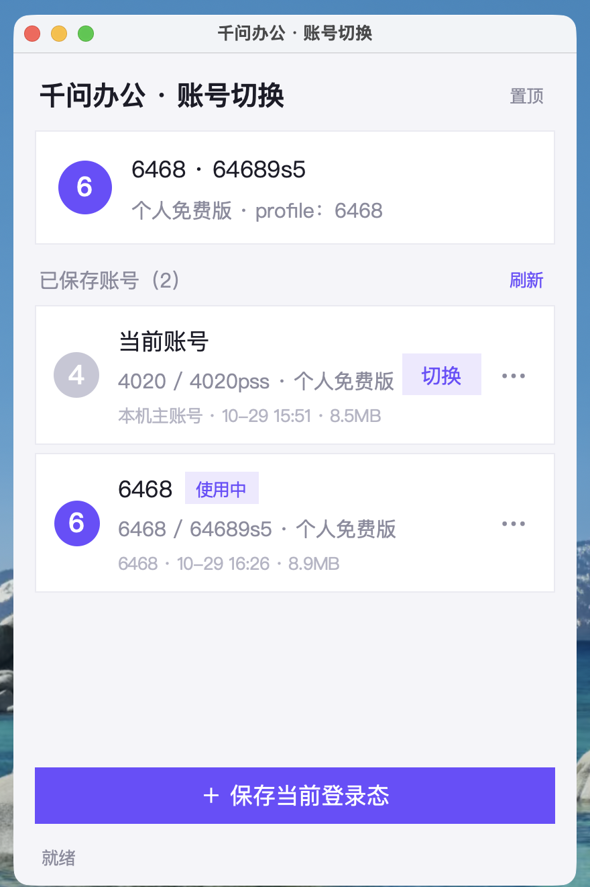
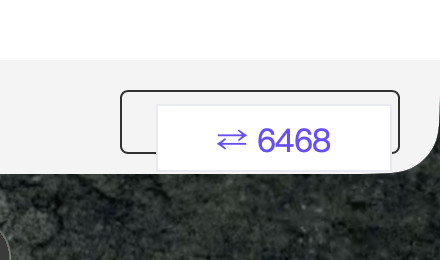
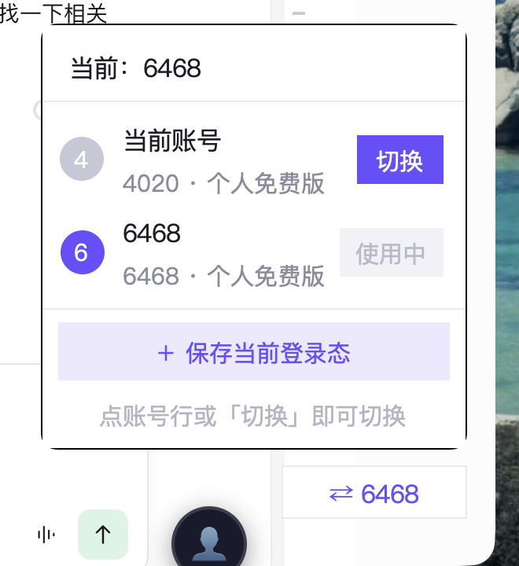

# 千问办公 账户一键切换工具

照着本机已有的「Trae CN 账户一键切换工具」做的。两版核心思路一样（备份/还原登录态），
但千问办公的登录态不在一个目录里，而且它**屏蔽了 CDP 调试端口**，所以 GUI 从「界面内注入
悬浮按钮」改成了「独立小窗口」。



## 更新日志

- **v1.1** — 修掉悬浮按钮的内存泄漏：CoreFoundation 的 CFArray/CFString 从不 `CFRelease`、
  ObjC 的自动释放对象没有 autoreleasepool 兜底，约 **3 GB/天**，挂几天就顶到 9 GB。
  详见「踩过的坑 → v1.1：那个吃掉 9GB 的内存泄漏」。修复后稳定在 46 MB。
- **v1.0** — 首个发布版：命令行 / 图形界面 / 贴着窗口的悬浮按钮，切换不再互相覆盖。

## 快速开始

```bash
./install.sh          # 装命令行：~/.local/bin/qwenwork-switch
./install-gui.sh      # 装图形界面：~/Applications/千问办公切换器.app
./install-fab.sh      # 装悬浮按钮：~/Applications/千问办公悬浮钮.app
```

- 命令行：`qwenwork-switch`（交互菜单）/ `save` / `switch` / `list` / `current` / `doctor`
- 图形界面：双击 `~/Applications/千问办公切换器.app`，或 `qwenwork-switch gui`

## 登录态在哪里

```
~/.qwenworkcn/                              ← SDK 侧
├── .status.json            ← 当前账号明文快照（本工具靠它识别身份）
├── .auth/                  ← 凭证事务 / machine_id
├── identity-data/          ← 身份维度数据根
├── qwapp-identities/       ← 应用侧身份数据（host-content.db）
├── engine-maas-key.dat     ← 模型网关密钥（随账号）

~/Library/Application Support/QwenWorkCN/   ← Electron 侧
├── auth.dat / auth-v2.dat  ← safeStorage 加密的登录凭证
├── Cookies / Cookies-journal
├── Local Storage / Session Storage
├── Partitions/             ← webview 分区，网页登录态真正落在这里（6.8MB）
├── identity-claim/         ← 身份认领状态 awaiting_login → claimed
└── identities/             ← 身份维度的连接器配置
```

两个根目录**必须一起换**：只换 Electron 侧会出现「界面显示 B、请求仍是 A」的串号状态。

## 原理

切换 = **退出应用 → 快照当前登录态 → 覆盖目标 profile 的数据集 → 拉起应用**。
切换瞬间会把「即将被覆盖的那份登录态」自动回写到它自己所属的 profile，所以 A → B → A
来回切不会掉登录。

刻意**不动**的东西（避免丢数据 / 触发风控）：

| 忽略项 | 原因 |
|---|---|
| `logs/ Cache/ Code Cache/ Crashpad/ diagnostics/ tmp/` | 缓存与日志，与账号无关 |
| `machine-id`、`installation_id`、`umid-cache.json` | 设备级标识，切换账号不该变 |
| `bin/ skills/ commands/ .models/` | 共享资源，重下很贵 |
| `data/agents.identity-v2.db` | 会话与智能体工作数据，保留以免丢历史 |

### 三条安全规则（16:26 那次覆盖事故之后加的）

1. **保存后 active 立刻跟着走**。刚保存的就是应用里正在跑的登录态，界面上的「使用中」
   必须落在它上面。否则会出现「明明已经存了新账号，界面还说旧 profile 在使用中」，
   诱导用户再点一次「切换」——这正是事故的起点。
2. **切换时的「回写旧 profile」必须先核对账号**。只有「当前登录账号」与「旧 profile
   记录的账号」两者都识别得出且相同时，才允许回写；任一侧识别不出来就不动。
   不一致时把当前登录态另存到 `~/.qwen-work-switcher/trash/`，并明确警告。
3. **保存时检测重复**：同一账号、同样体积的 profile 已存在时给出提示，避免无意义副本。

回归测试覆盖了这三条：`python3 test/test-switch-guard.py`。


## 悬浮按钮（贴窗口右下角）



点一下按钮弹出账号面板，**点账号行任意位置、或右侧紫色的「切换」按钮**即可切换：



当前账号显示灰色「使用中」；非当前账号右侧是紫色「切换」。切换会先退出千问办公、
替换登录态后自动重新拉起，全程约 1 秒。

`fab.py` 是一个常驻的小胶囊，贴在**千问办公窗口的右下角**，跟着窗口移动/缩放；
窗口不可见或未启动时退到屏幕右下角。点一下弹出账号列表，点账号直接切换。

- 左键：打开账号面板（账号行 / 使用中标记 / 保存当前登录态）
- 拖动：自由摆放（拖过就不再跟随，右键「回到窗口右下角」可恢复）
- 右键：保存当前登录态 / 打开完整窗口 / 切换是否跟随 / 回到窗口右下角 / 退出

**不占 Dock、也不出现在 ⌘⇥**：运行时通过 ObjC 把 App 切成 `NSApplicationActivationPolicyAccessory`
（`lsappinfo` 里会显示 `type="UIElement"`）。这比在 Info.plist 写 `LSUIElement` 更稳——后者会让
Tk 窗口干脆不渲染。因为不占 Dock，退出只能用右键菜单里的「退出悬浮按钮」。

**跟着窗口一起显示/消失**：每 400ms 用 `CGWindowListCopyWindowInfo`（只看屏上窗口）扫一遍，
窗口最小化、⌘H 隐藏、切到别的桌面、或缩得太小（<260×200）时按钮一并隐藏；窗口回来就自动回到
右下角。App 没启动同样隐藏。想让它一直显示，就右键关掉「跟随窗口」。

**只在前台是千问办公时显示**（默认开）：置顶是全局的，悬浮窗没法"只在某个窗口之上"。
判据是「`CGWindowList` 里第一个正常层的窗口（layer 0、尺寸够大）是不是千问办公」——
这个列表本身就是从前往后排序的，所以第一扇窗口就属于前台应用。自己的悬浮钮和账号面板
按 **pid** 排除，因此"用户正在点按钮"这种情形天然算作"前台是千问办公"，不会自己闪掉。

> v1.0 这里用的是 `NSWorkspace.frontmostApplication.localizedName`，判得更准一点，
> 但每轮都要走 ObjC + CFString 且没有 autoreleasepool 兜底 —— 正是 9GB 泄漏的另一半
> （见下方「v1.1：9GB 内存泄漏」）。换成 CG 排序法后整条路径零 ObjC、零分配。

窗口位置的读取靠 CoreGraphics 的 `CGWindowListCopyWindowInfo`（ctypes 直调，无需任何权限）。
注意 owner 名是本地化的 **「千问办公」**，不是进程名 `QwenWorkCN`——按进程名过滤会一个窗口都找不到。

安装与启动：

```bash
./install-fab.sh                       # → ~/Applications/千问办公悬浮钮.app
open ~/Applications/千问办公悬浮钮.app
# 或
qwenwork-switch fab
```

窗口位置的读取靠 CoreGraphics 的 `CGWindowListCopyWindowInfo`（ctypes 直调，无需任何权限）。
注意 owner 名是本地化的 **「千问办公」**，不是进程名 `QwenWorkCN`——按进程名过滤会一个窗口都找不到。

### 为什么按钮不在页面里（和 Trae 不一样）

Trae 是 Electron + CDP 注入悬浮 DOM。千问办公这条路我逐条试过，全部堵死：

| 尝试 | 结果 |
|---|---|
| `--remote-debugging-port=9230` 直接执行二进制 | 应用自己的参数解析器拒绝：`bad option`，进程退出 |
| `open -na ... --args --remote-debugging-port=9231` | 同上，应用不启动 |
| 复制一份 app，把 asar 里 `if (false) appendSwitch("remote-debugging-port", …)` 改成 `if (!0   )`，重签名启动 | 端口始终不监听——这行是构建时被裁掉的死代码，且 JS 运行时执行已晚于 Chromium 初始化 |
| 同上但把 `initLinuxPasswordStore()` 改成注入固定端口（主进程 pre-ready 阶段） | 仍然没有端口：`appendSwitch` 对调试端口无效，必须由启动参数给出 |

结论：**不深入改应用（重打包 asar 且能过签名）就无法拿到 CDP**。而改主程序会破坏签名、
每次应用升级都要重打补丁，风险远大于收益。所以这里做成“紧贴窗口的独立小窗口”：
视觉位置一样、点击路径一样，代价是它不属于页面 DOM（不会随页面滚动/隐藏）。

## 数据安全与恢复

- 被替换、或被保护逻辑拦下的登录态，统一留在 `~/.qwen-work-switcher/trash/`，
  命名形如 `<profile>-切换前登录态-<时间戳>`，**不会自动删除**。
- 每次覆盖前都会先把当前登录态快照到 `.current-backup`，切换中途失败可 `qwenwork-switch restore`。
- 真出事了还有 macOS 本地快照兜底（本次事故就是靠它救回来的）：

```bash
# 1. 找事故时间点之前的快照
tmutil listlocalsnapshots /

# 2. 直接浏览（不需要 sudo）
ls "/Volumes/com.apple.TimeMachine.localsnapshots/Backups.backupdb/MacBook/<时间戳>/Data/Users/$USER/.qwen-work-switcher/profiles/"

# 3. 把旧 profile 拷回来
cp -R "<快照路径>/当前账号" ~/.qwen-work-switcher/profiles/当前账号
```

拷回后要让 GUI 重新读到正确的账号信息：删掉该 profile 的 `profile-meta.json` 不会自动修
`manifest.json`，建议直接把 manifest 里对应的 `identity` / `size` 改成实际值，或删掉这条
记录重新 `save` 一次。

## 图形界面

`gui.py` 是 Tkinter 单窗口程序，逻辑全部 import 自 `switcher.py`，没有第二套实现。

- 顶部：当前账号卡（头像 / 名字 / 套餐 / 关联 profile）
- 列表：每行一个账号，显示账号名、实际用户名、套餐、备注、快照时间与体积
  - 点「切换」或双击行 → 确认后切换（会先退出千问办公，切完自动拉起）
  - 点「⋯」→ 切换到该账号 / 重命名 / 改备注 / 删除
- 底部：「＋ 保存当前登录态」把当前登录的账号存成快照
- 右上角「📌 已置顶」：窗口常驻最前，可当小挂件用；窗口大小与位置会记住

切换在后台线程执行，界面不卡；状态栏显示进度。

### 为什么不用 CDP 注入

Trae CN 版是「守护进程 + CDP 注入悬浮按钮」。千问办公这条路走不通：

```bash
open -na /Applications/Agent/QwenWorkCN.app --args --remote-debugging-port=9230
# 进程起得来，但 9230 没有任何监听；直接执行二进制会报：
# QwenWorkCN: bad option: --remote-debugging-port=9230
```

应用自己的参数解析器把 Chromium 开关挡掉了，整个进程只监听一个内部端口（`lsof -p` 可见）。
所以改为独立窗口方案，不依赖任何注入点，也不改千问办公本体。

### 依赖：需要一个 Tk 8.6+ 的 Python

macOS 自带的 `/usr/bin/python3` 只有 **Tk 8.5**，在这台机器上窗口会整块白屏、文字不绘制
（8.5 的框架太老，与新系统不兼容）。`run-gui.sh` 与 .app 启动器会按顺序挑第一个满足
`tkinter.TkVersion >= 8.6` 的解释器：

```
~/.workbuddy/binaries/python/versions/*/bin/python3   ← 本机命中 Tk 9.0
/opt/homebrew/bin/python3.13 / 3.12 / python3
/Library/Frameworks/Python.framework/...
/usr/bin/python3                                       ← 兜底，可能白屏
```

CLI 部分（`switcher.py`）只用标准库，Python 3.9+ 都能跑，不受这个限制。

## 命令行用法

```bash
qwenwork-switch                       # 交互式菜单
qwenwork-switch save work             # 把当前登录态存为 'work'
qwenwork-switch save home --note "个人号"
qwenwork-switch switch work           # 切到 'work'（自动退出 + 重启千问办公）
qwenwork-switch list                  # 列出所有账号，标出正在用的
qwenwork-switch current               # 当前账号 + 套餐 + 关联 profile
qwenwork-switch edit work --rename office --note "公司号"
qwenwork-switch delete work -y
qwenwork-switch backup / restore      # 手动备份 / 恢复
qwenwork-switch gui                   # 打开图形界面
```

## 首次使用

1. 在千问办公里登录 **账号 A** → 退出
2. `qwenwork-switch save a`（或打开 GUI 点「＋ 保存当前登录态」）
3. 打开千问办公，退出登录，登录 **账号 B** → 退出
4. 再保存一次，命名为 `b`
5. 之后 `switch a` / `switch b` 或 GUI 点一下就切

## 数据存储

```
~/.qwen-work-switcher/
├── manifest.json               # 账号清单 + 当前 active
├── profiles/<名称>/            # 每个账号一份完整登录态（约 8–9MB）
│   ├── sdk/…                   # 对应 ~/.qwenworkcn
│   ├── app-support/…           # 对应 Application Support/QwenWorkCN
│   └── profile-meta.json       # 账号信息 / 大小 / 保存时间
├── .current-backup/            # backup 命令的临时快照
├── gui.json                    # GUI 窗口尺寸/位置/置顶
├── gui-launch.log              # .app 启动日志
└── switcher.log                # 操作日志（SAVE / SWITCH / REFRESH / DELETE）
```

## 踩过的坑

**切换/备份相关**

- **（已修复）切换会覆盖旧 profile**：初版 `save` 不改 `active`，界面把「使用中」标在旧
  profile 上；用户以为要再点「切换」，而切换时的「回写旧 profile」会把当时正在运行的新账号
  数据写进旧 profile，两份快照就此变成同一个账号。修复见上文「三条安全规则」。
- **osascript 会卡住**：首次 `tell application "QwenWorkCN" to quit` 会弹「控制其他 App」
  的自动化授权框，没人点就永久阻塞（实测一次切换卡了 2 分 54 秒）。现在 AppleScript
  只等 5 秒，超时自动降级 `pkill -TERM` → `pkill -KILL`，单次切换稳定在 1 秒级。
- **进程名别用模糊匹配**：`pgrep -f Qwen` 会命中一堆无关进程，必须 `pgrep -x QwenWorkCN`；
  `qwenworkhelper` 是它的子进程，也要一起收掉，否则文件锁占用导致还原失败。
- **两个根目录必须都换**：见上文「登录态在哪里」。
- **`.status.json` 是金矿**：`logged_in / username / email / plan` 明文可读，识别账号
  不用去解 safeStorage。

**GUI 相关**

- **Tk 8.5 白屏**：见上文依赖说明。症状是窗口出来了但一片空白、一个文字都不画。
- **`.app` 不能引用 `~/Documents` 里的脚本**：由 launchd 启动的 app 去执行
  `~/Documents/...` 下的 shell 脚本会报 `Operation not permitted`（TCC 保护）。
  解决办法是把 `gui.py`、`switcher.py` 拷进 `.app/Contents/Resources/app/` 里自包含。
  **改过这两个文件后要重跑 `./install-gui.sh`**，否则 .app 里还是旧代码。
- **Tkinter 不是线程安全的**：切换跑在后台线程，早期版本直接从子线程调 `root.after()`
  更新界面，会抛 `main thread is not in main loop` 并把界面永久卡在 busy 状态。
  现在改成子线程只往 `queue.Queue` 塞结果，主线程 `after(80)` 轮询取。
- **`tk scaling 1.0` 不要碰**：Retina 屏上会把内容按半尺寸绘制，看起来像布局崩了。
- **`tk.Button` 在 macOS 上是原生灰按钮**：`bg` 不生效，想要自己的配色得用 `tk.Label`
  + 点击绑定（见 `flat_btn()`）。
- **Label 不会自己省略**：长文本会硬切开，用 `fit_px()` + `<Configure>` 按实际宽度裁剪。

### v1.1：那个吃掉 9GB 的内存泄漏

用户报「悬浮按钮占用了 9G 内存」。排查过程本身就是个坑：

**1. 别用 RSS 判断。** `ps` 看这个进程只有 30MB，看着很健康。但 `phys_footprint` 是 9684MB——
泄漏的页早被内存压缩器换出去了，RSS 只统计实际驻留的那部分。用 libproc 才能看到真实占用：

```python
PROC = ctypes.CDLL("/usr/lib/libproc.dylib")
PROC.proc_pid_rusage(os.getpid(), 2, ctypes.byref(buf))   # RUSAGE_INFO_V2
buf.ri_phys_footprint                                     # ← 真正该盯的数字
```

**2. CoreFoundation 的 Copy/Create 规则，Python 的 GC 管不到。** 凡是名字带 `Copy` 或
`Create` 的 API，返回的对象引用计数是 1，**必须由调用方 `CFRelease`**。v1.0 每 400ms 调一次
`CGWindowListCopyWindowInfo()` 却从不释放返回的 CFArray，还给**每个窗口**现建 5 个 CFString
当字典 key（`kCGWindowOwnerName`、`X`、`Y`、`Width`、`Height`…），这些全是内存垃圾。

**3. ObjC 的自动释放对象同样需要池子。** `NSWorkspace.frontmostApplication.localizedName`
拿到的是 autoreleased 对象，而 Tk 的主循环里没有 `NSAutoreleasePool` 兜底，于是它们永远
不会 drain。

实测单项成本（500 次循环，用 `ri_phys_footprint` 差值）：

| 调用 | v1.0 | v1.1 |
|---|---|---|
| `CGWindowListCopyWindowInfo` 那一路 | **13.7 KB/次** | 0.0 KB/次（2 万次后收敛在 +48KB） |
| `NSWorkspace` 那一路 | **1.1 KB/次** | 已整条删掉 |
| `detect_identity()` | 0 | 0 |
| `is_running()` | 0.3 KB/次 | 0.3 KB/次（改 2.5s 一次） |

14.8 KB × 2.5 次/秒 ≈ 37 KB/s ≈ **3 GB/天**。挂三天就是 9GB，对得上。

修法（`fab.py`）：

- dylib 只 `CDLL` 一次，别在热路径里反复加载；
- 字典 key 启动时预建（`_key()` / `_owner_key()`），全程复用，不再每窗每次新建 CFString；
- `CGWindowListCopyWindowInfo` 返回的 CFArray 用 `try/finally` 保证 `CFRelease`；
- owner 名比较改用 `CFEqual(窗口owner, 缓存的CFString)`，连字符串转换都省了；
- **前台判断不再用 NSWorkspace**：`CGWindowList` 本身就是从前往后排序的，第一个正常层
  （layer 0、≥60×40、非自己 pid）的窗口就属于前台应用 —— 一趟扫描同时拿到窗口矩形和
  前台判定，零 ObjC；
- `paint()` 只在文本真的变了才 `configure`；`is_running()`（会 fork `pgrep`）从 2.5 次/秒
  降到 0.4 次/秒；`tk.Menu` 用完 `destroy()`；
- 加了兜底：每 30 秒量一次自己的 `phys_footprint`，超过 480MB 就 `os.execv` 自愈重启
  （正常运行时 46MB，几乎不可能触发）。

修复后实测 3 分钟曲线：footprint 稳定在 **45.9 MB 不动**，2 万次 `Screen.snapshot()`
累计只增加 48KB（分配器预热，不是增长）。

## 文件

| 文件 | 说明 |
|---|---|
| `switcher.py` | 全部切换逻辑 + CLI + 交互式 TUI（纯标准库） |
| `install.sh` | 装 CLI 到 `~/.local/bin/qwenwork-switch` |
| `gui.py` | Tkinter 图形界面，逻辑复用 `switcher.py` |
| `run-gui.sh` | 挑选 Tk 8.6+ 的 Python 并启动 GUI |
| `install-gui.sh` | 打包 `~/Applications/千问办公切换器.app`（自包含） |
| `fab.py` | 悬浮按钮（贴窗口右下角 + 账号面板） |
| `run-fab.sh` | 挑选 Tk 8.6+ 的 Python 并启动悬浮按钮 |
| `install-fab.sh` | 打包 `~/Applications/千问办公悬浮钮.app` |
| `screenshot.png` / `fab-screenshot.png` | 界面截图 |
| `test/test-switch-guard.py` | 回归测试：保存/切换不得互相覆盖 |
| `test/test-fab-click.py` | 回归测试：悬浮面板每行所有控件都绑了点击 |
| `test/test-fab-memory.py` | 回归测试：热路径不许泄漏（`phys_footprint` 判据） |
| `README.md` | 本文档 |
